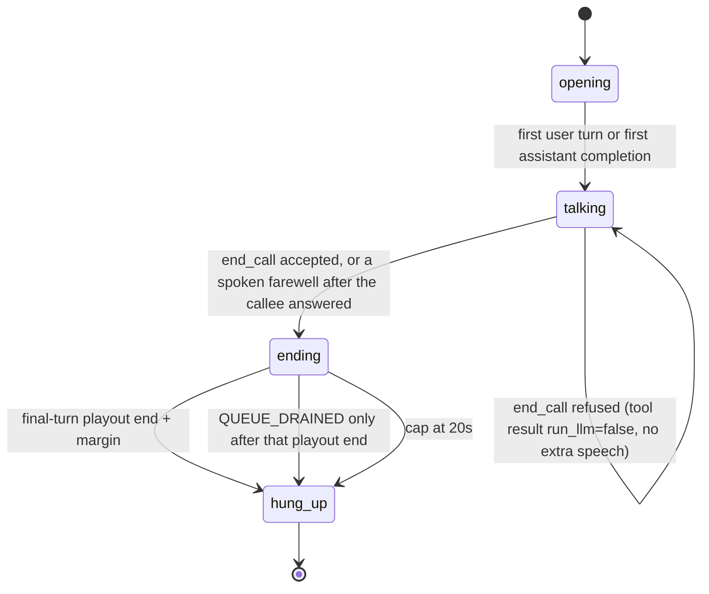

# Call flow (M2)

One object, `CallPhase`, owns the phase. Processors only read it.
Question and goodbye state are not stored anywhere else.

## When `end_call` is accepted

- The callee has spoken after the last assistant turn that asked or requested anything,
  or the callee said goodbye and this turn does not ask.
- An ask is the full text of that completion: a `?`, or an indirect German ask
  (`wollte fragen, ob`, `möchte wissen, ob/wann/wie`, `ob Sie`, `könnten Sie`,
  sentence-initial w-words). The next user turn clears it.
- Message delivery (no ask in the turn) may call `end_call` in the same turn.
- A callee goodbye followed by `end_call` hangs up when that turn is not itself an ask.
- If the model says goodbye in plain text (`Auf Wiederhören`, `Tschüss`) after the callee
  has answered, that is an `end_call` with no extra goodbye line.
- Tool-shaped assistant text (`end_call(...)`, JSON tool blobs, `<tool_call>`, bare
  function names) is never spoken. A textual `end_call(...)` becomes a real `end_call`;
  only its `goodbye` argument is spoken.

A refused `end_call` returns the tool error with `run_llm=false`. The bot waits for the
next user turn. It does not ask the model again, and it does not apologize for the refusal.

## While `ending`

No LLM run, no filler, no delay apology, no rerun. Then one hangup path.

`BotStoppedSpeaking` means the pipeline finished **queueing** audio. Pipecat writes
that queue on a later task, and a fast TTS (or a cache hit) can queue several
seconds of audio in a few hundred milliseconds. Tearing the call down on
`TTSStopped`, or on a `QUEUE_DRAINED` of only the audio Asterisk has seen so far,
cuts off the thanks and the goodbye.

`pipecat-asterisk`'s flow controller already paces onto the websocket with bounded
lookahead (chan_websocket holds 20 s, the high-water mark stops sending at 16 s, and
one message is at most ~2 s of 16 kHz PCM). Frames dropped before they reach that
buffer never play. The hangup path therefore waits until the final turn's audio has
been written, then until it has had real time to play.

The final turn is everything written since the last interruption: the pre-goodbye
sentence and the goodbye, including a cache hit. A later `TTSStarted` does not zero
that sum. The pre-goodbye sentence's `TTSStopped` is not the end of the turn.

1. Once every TTS context of the turn has stopped, and the output queue has been
   written, freeze the deadline: first write + sum of written durations + the margin,
   700 ms (`FERNRUF_HANGUP_MARGIN_MS`). The running clock's tail is not the deadline
   when audio was written faster than real time. A gap can only make it later.
   Capped at 20 s. Logged as `Final-turn audio Nms written; playout clock end +Nms
   from first write`.
2. Then send `REPORT_QUEUE_DRAINED` (logged). `QUEUE_DRAINED` before the playout end
   is logged and does not hang up. A drain after the playout end waits the margin,
   and never hangs up before the deadline. If no drain arrives, hang up at the
   deadline. The hangup line repeats total audio, playout-clock end, drain time, and
   hangup time, each as an offset from the first write.
3. Nothing is written after that seal. A late silence, comfort-noise, or filler frame
   is dropped and does not bump the drain generation.

Barge-in, cancel, and stop flush Asterisk (`FLUSH_MEDIA`) and may pull the deadline
earlier. A `QUEUE_DRAINED` from before the audio is written, or from before the
request, is ignored.

Hangup calls the existing hook, which tears the PSTN leg down first, then the bridge, then
the WebSocket (`fernruf/ari/teardown.py`).

## What is not a stall

An empty completion with `finish_reason=stop`, and a run skipped because the call is
already ending, are "nothing to say". They do not start the timeout apology.
A real first-token stall may speak the apology once per call, after the fallback model
has also failed.
